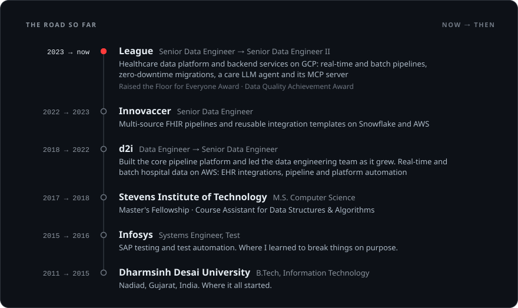

  <b>Hi, I'm Maulik Jajal.</b> Data trailblazer, AI agent mastermind, relentless troubleshooter, and data-platform architect.
   
  <i>Usually all four before lunch.</i> ☕⚡

  

### Things I code with

**Right now**

  
  
  
  
  
  
  
  
  
  
  
  
  
  
  
  
  
  
  
  
  

**With AI in the loop**

  
  
  
  
  
  

**Along the way**

  
  
  
  
  
  
  
  
  
  
  
  
  
  
  
  
  

### My work

Almost everything I build lives in private repos, so this skyline is the public view of it. Each block is one day, and the taller it stands, the more I shipped.

### The road so far

### What I geek out on

- AI agents and MCP servers that take the busywork, so I can stay focused on data system architecture
- Building ML, data science, LLM and RAG pipelines
- Moving live data to a new home without anyone noticing it moved
- Streaming and batch pipelines that stay boring in production
- Chasing a bug to its root cause, not the nearest workaround
- Healthcare data that actually talks to other healthcare data (FHIR, HL7)
- Automation that takes real work off the on-call rotation

  

  This page redraws itself every day. A small <a href="./scripts/build_profile.py">Python script</a> reads my contribution calendar and <a href="./.github/workflows/refresh-profile.yml">GitHub Actions</a> does the rest.

